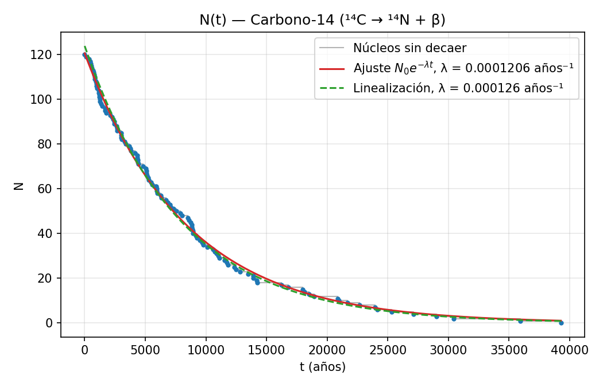
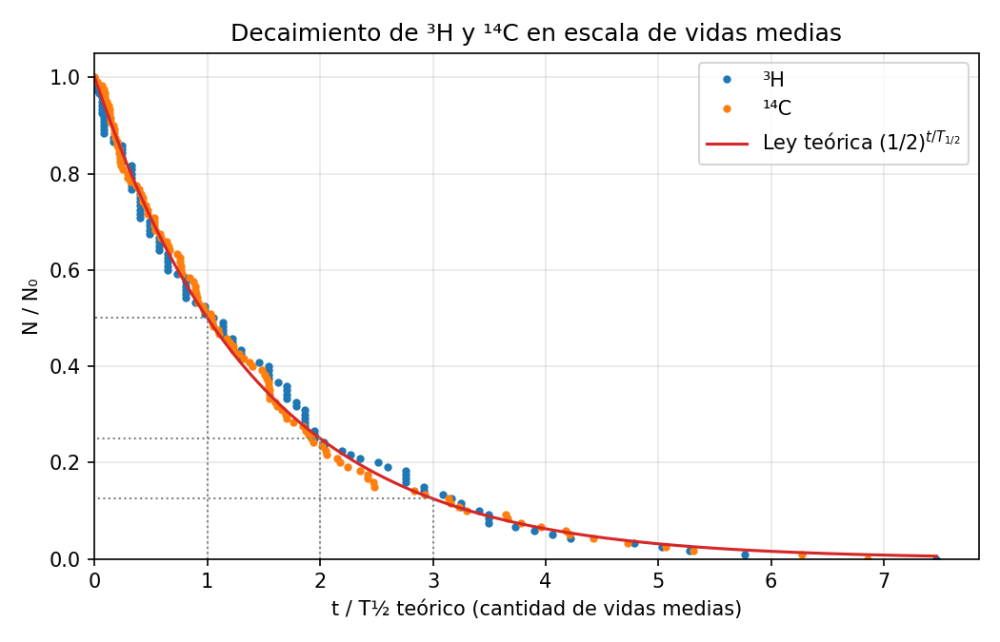

# Decaimiento β: medición automatizada sobre una simulación de PhET

Mide de forma automática 120 tiempos de desintegración de ³H y ¹⁴C en la simulación
[Desintegración Beta](https://phet.colorado.edu/es/simulation/legacy/beta-decay) de PhET,
arma la tabla de núcleos sin decaer N(t), hace la regresión y calcula la constante de
decaimiento λ y el período de semidesintegración T½.

Nació de una práctica de laboratorio de Física 2 (Lic. en Biotecnología), donde hay que
repetir 120 veces a mano el mismo procedimiento —reponer el núcleo, esperar el decaimiento,
anotar el tiempo— para cada uno de los dos núcleos. Son 240 mediciones que se pueden
automatizar sin cambiar nada del método.

## Resultados

Con 120 mediciones por núcleo, comparando contra los valores de literatura:

| Núcleo | Método | λ (años⁻¹) | R² | T½ exp (años) | T½ teórico (años) | ΔT½ |
|---|---|---|---|---|---|---|
| ³H | Linealización ln N vs t | 0.0581 ± 0.0006 | 0.986 | 11.93 ± 0.13 | 12.32 | −3.1 % |
| ³H | Ajuste exponencial | 0.0525 ± 0.0005 | 0.996 | 13.21 ± 0.11 | 12.32 | +7.3 % |
| ¹⁴C | Linealización ln N vs t | (1.260 ± 0.008) × 10⁻⁴ | 0.995 | 5500 ± 35 | 5730 | −4.0 % |
| ¹⁴C | Ajuste exponencial | (1.206 ± 0.009) × 10⁻⁴ | 0.997 | 5750 ± 41 | 5730 | +0.35 % |



Midiendo el tiempo en cantidad de vidas medias, los dos núcleos caen sobre la misma curva,
aunque sus escalas de tiempo se diferencian en un factor de casi 500:



## Cómo funciona

La simulación es un programa Java de 2008 que hoy corre en el navegador compilado a
JavaScript (CheerpJ). Dibuja **todo** —incluido el recuadro "Tiempo de decaimiento"— como
píxeles en un `<canvas>`, así que no hay ningún texto en la página para leer: ni DOM, ni
accesibilidad, ni `fillText` (verifiqué que solo usa `putImageData`).

Las alternativas eran OCR sobre la imagen del recuadro, que es frágil porque la simulación
cambia de formato según el valor ("6 años", "315 días", "29.02 x 10³ años"), o buscar el
dato en el programa mismo. Opté por lo segundo.

El script automatiza el navegador con [Playwright](https://playwright.dev/python/) y, antes
de que cargue la simulación, inyecta un *getter/setter* en `Object.prototype` que espía dos
campos del código Java compilado:

| Campo | Qué guarda |
|---|---|
| `_totalUndecayedLifetime16` | el tiempo de vida que la simulación le sortea al núcleo al reponerlo |
| `_currentTimeInMilliseconds38` | el valor que alimenta el recuadro "Tiempo de decaimiento" |

Con eso, cada medición consiste en apretar "Reponer Núcleos", esperar a que el núcleo
decaiga de verdad (se detecta cuando le cambia el número de protones) y anotar el tiempo.
Se guardan dos valores: el que muestra el recuadro, redondeado igual que la simulación, y
el tiempo exacto sin redondeo.

Para comprobar que la lectura es correcta, el modo `--prueba` guarda una captura del
recuadro en cada medición. Las 20 capturas de la corrida de prueba coincidieron con lo
anotado.

## Instalación

```bash
pip install -r requirements.txt
```

Usa el Google Chrome ya instalado. Si no hay ninguno:

```bash
python3 -m playwright install chromium
```

## Uso

```bash
python3 medir_decaimiento.py            # 120 mediciones de cada núcleo (~25 min)
python3 medir_decaimiento.py --prueba   # 10 de cada uno, con capturas, en prueba/
python3 medir_decaimiento.py --nucleo H3
python3 medir_decaimiento.py --oculto   # sin mostrar la ventana del navegador
```

Al terminar llama solo a `analizar.py`, que también se puede correr aparte:

```bash
python3 analizar.py
```

Genera:

- `H3_ordenados.xlsx` y `C14_ordenados.xlsx`: los tiempos de menor a mayor, con N y ln N.
- `decaimiento_beta.xlsx`: una hoja por núcleo y una hoja de resumen con las regresiones.
- `graficos/`: N(t), la linealización ln N vs t, la comparación en vidas medias y los
  histogramas de los tiempos.
- `datos/`: los tiempos crudos en CSV, en el orden en que se midieron.

## Estructura

```
medir_decaimiento.py   automatiza la simulación y guarda los tiempos
analizar.py            ordena, arma N(t), hace las regresiones y genera planillas y gráficos
datos/                 tiempos crudos de la corrida incluida en el repositorio
graficos/              gráficos generados
```

## Método

Los tiempos se ordenan de menor a mayor y se construye N(t) con N(0) = 120: después del
i-ésimo decaimiento quedan 120 − i núcleos sin decaer. Sobre esos puntos se aplican dos
regresiones:

- **Linealización:** `ln N = ln N₀ − λt`, regresión lineal, λ sale de la pendiente.
- **Ajuste exponencial:** `N(t) = N₀e^(−λt)`, mínimos cuadrados no lineales.

Después, `T½ = ln2 / λ` y la diferencia relativa `ΔT½ = (T½exp − T½teórico) / T½teórico × 100 %`.

Como control, el script también calcula `T½ = ln2 · (promedio de los tiempos)`, que es el
estimador de máxima verosimilitud para una distribución exponencial.

Los dos métodos no dan el mismo λ con los mismos datos: la linealización le da mucho peso a
los últimos puntos (N = 1, 2, 3), que son los más afectados por el azar. Con 120 núcleos, la
incerteza estadística esperable es de alrededor del 9 %.

## Limitaciones

- Los nombres de los campos (`_totalUndecayedLifetime16`, `_currentTimeInMilliseconds38`)
  los genera el compilador de CheerpJ. Si PhET recompila la simulación, pueden cambiar y hay
  que volver a buscarlos en `nuclear-physics_all.jar.js`.
- Los clics van por coordenadas fijas del lienzo de 1024×768 de la simulación. Si cambia la
  interfaz, hay que actualizar las constantes del principio del script.
- El recuadro de la simulación tiene resolución limitada para tiempos cortos: varios núcleos
  distintos muestran "270 días". Por eso se guarda también el tiempo exacto.

## Créditos

Autora: **Rocío Sandez**. Práctica de laboratorio de Física 2, Lic. en Biotecnología.

La simulación [Beta Decay](https://phet.colorado.edu/es/simulation/legacy/beta-decay) es de
PhET Interactive Simulations, University of Colorado Boulder. Este proyecto solo la
automatiza desde afuera: no incluye, redistribuye ni modifica su código. Hace un uso liviano
del sitio, un núcleo por vez, igual que una persona midiendo a mano.

## Licencia

MIT (ver [LICENSE](LICENSE)).
